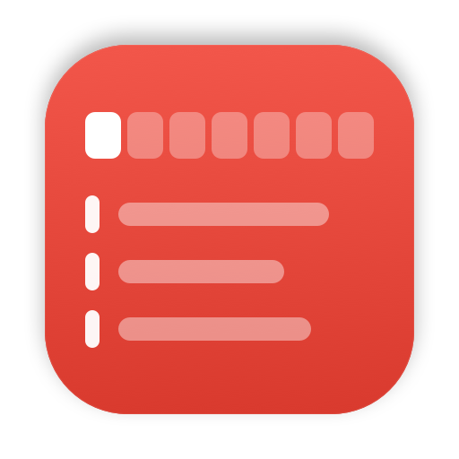
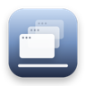

# UMST — Free Desktop Calendar for Mac

<p><b>Ultimate Mac Scheduling Tool</b> · <a href="https://nicoleyangcoding.github.io/UMST-UltimateMacSchedulingTool/">Website</a> · <a href="https://github.com/nicoleyangcoding/UMST-UltimateMacSchedulingTool/releases/latest">Download</a></p>

**A free, open-source desktop calendar for macOS.** See Google Calendar, iCloud, Outlook, Apple Reminders, Canvas, Blackboard, Brightspace, Moodle, Schoology, Todoist, Asana and Trello in one glass widget on your desktop, and add to-dos from the menu bar in two keystrokes.

<table><tr><td>
<a href="https://github.com/stanczykwyatt/show-desktop"></a>
<b>Comes with <a href="https://github.com/stanczykwyatt/show-desktop">Show Desktop</a> by <a href="https://github.com/stanczykwyatt">@stanczykwyatt</a>.</b> A calendar on your desktop only helps if you can see your desktop. Click Show Desktop's menu bar icon (or press <kbd>⌃⇧D</kbd>) and every window gets out of the way. Click again and they all come back exactly where they were. It's free and open source too, so <a href="https://github.com/stanczykwyatt/show-desktop">give it a star</a> if it saves you time.
</td></tr></table>


[](#requirements)
[](Sources/UMST)
[](LICENSE)
[](https://github.com/nicoleyangcoding/UMST-UltimateMacSchedulingTool/releases/latest)

## Install

Paste this into Terminal:

```sh
curl -fsSL https://raw.githubusercontent.com/nicoleyangcoding/UMST-UltimateMacSchedulingTool/main/install.sh | zsh
```

It downloads the latest release, checks its SHA-256 checksum, installs `UMST.app` to `~/Applications` and opens it. It also installs [Show Desktop](https://github.com/stanczykwyatt/show-desktop) from its own GitHub releases. Run the same command again to update both.

To install UMST without Show Desktop:

```sh
curl -fsSL https://raw.githubusercontent.com/nicoleyangcoding/UMST-UltimateMacSchedulingTool/main/install.sh | SHOW_DESKTOP=0 zsh
```

<details>
<summary>Other ways to install</summary>

**Download.** Get `UMST.zip` from the [latest release](https://github.com/nicoleyangcoding/UMST-UltimateMacSchedulingTool/releases/latest), unzip it and move `UMST.app` to Applications. Get Show Desktop the same way from [its releases](https://github.com/stanczykwyatt/show-desktop/releases/latest). UMST isn't notarized by Apple yet, so the first time you open it macOS will block it: go to **System Settings → Privacy & Security** and click **Open Anyway**.

**Build from source.** Requires the Xcode Command Line Tools (`xcode-select --install`).

```sh
git clone https://github.com/nicoleyangcoding/UMST-UltimateMacSchedulingTool.git
cd UMST-UltimateMacSchedulingTool
./scripts/install-from-source.sh
```
</details>

## Features

**Desktop calendar**
- A calendar widget that sits on your desktop, under your windows, showing the next two weeks.
- Everything in one place: every calendar on your Mac, Apple Reminders, your school's LMS and your task apps.
- Drag it anywhere; it remembers where you put it. Tap a day in the week strip to jump to it.
- Check off to-dos and reminders right on the calendar.

**Quick add**
- Click the calendar-plus icon in the menu bar, type, press Return. Right-click it for Refresh, Settings and Quit.
- Items go on today by default and disappear at midnight. Pick Tomorrow or any date with one click.

**Themes and animations**
- Six themes: Glass, Midnight, Sunset, Forest, Lavender and Graphite.
- Smooth, subtle animations you can turn off. Reduce Motion is respected automatically.

<p align="center">
  
  
</p>

## Connecting calendars

Open **Settings → Accounts** from the widget's `•••` menu, the person icon on the widget, or by right-clicking the menu bar icon. **Connect a Service…** walks you through each one.

| Service | How to connect |
| --- | --- |
| Google Calendar, Gmail, Google Classroom | Add the Google account in **System Settings → Internet Accounts** with Calendars on. Invites and events Mail finds in your email show up too. Or paste Google's *secret address in iCal format*. |
| iCloud, Outlook / Microsoft 365, Exchange, Yahoo | Same as above. Each calendar can be shown or hidden in Settings. |
| Apple Reminders | Turn on **Show reminders**. Reminders with a due date appear, and you can check them off from the widget. |
| Canvas | **Calendar → Calendar Feed** link, or a Canvas access token for the planner API. |
| Blackboard | **Calendar → Calendar Settings → Share Calendar** link. |
| Brightspace (D2L) | **Calendar → Settings → Enable Calendar Feeds**, then **Subscribe** and copy the link. |
| Moodle | **Calendar → Export calendar → Get calendar URL**. |
| Schoology | The calendar's iCal export link. |
| Todoist | **Settings → Integrations → Calendar Subscription URL**. |
| Asana | **My Tasks or a project → ▾ → Sync to calendar**. |
| Trello | The Calendar Power-Up's iCalendar feed link. |
| Anything else with an iCal / `.ics` / `webcal://` link | Paste it into **Other calendar link**. |

The calendar refreshes when you log in, about once an hour, at midnight, when your Mac wakes, the moment macOS Calendar or Reminders changes, and whenever you click refresh. If you go offline, it keeps showing what it last downloaded.

## How it compares

| | UMST | Itsycal | macOS Calendar widget | Fantastical |
| --- | :-: | :-: | :-: | :-: |
| Free and open source | ✓ | ✓ | – | – |
| Calendar on the desktop | ✓ | – | ✓ | ✓ |
| Canvas, Blackboard, Brightspace, Moodle, Schoology built in | ✓ | – | – | – |
| Todoist, Asana and Trello on the calendar | ✓ | – | – | Todoist |

UMST is built for students and anyone juggling school, work and personal calendars who wants everything in one glance, without a subscription.

## Privacy and security

- No accounts, no analytics, no servers. UMST only talks to the calendars and sites you add.
- Feed links and API tokens live in your macOS Keychain, never in plain files.
- HTTPS only, ephemeral network sessions (no cookies or cache on disk) and size-limited downloads.
- Data files are readable only by your user account. The app runs with the hardened runtime.

Details are in [PRIVACY.md](PRIVACY.md) and [SECURITY.md](SECURITY.md).

## Requirements

- macOS 14 Sonoma or later, Apple silicon or Intel

## Uninstall

```sh
curl -fsSL https://raw.githubusercontent.com/nicoleyangcoding/UMST-UltimateMacSchedulingTool/main/scripts/uninstall.sh | zsh
```

This removes the app, its settings, its data and its Keychain items. Show Desktop is a separate app and stays installed; to remove it, right-click its menu bar icon, quit it and move it to the Trash.

## Development

```sh
./scripts/test.sh                 # run the test suite
./scripts/build.sh                # build build/UMST.app (universal)
./scripts/install-from-source.sh  # build, install and launch
./scripts/release.sh              # test, build and package dist/UMST.zip
build/UMST.app/Contents/MacOS/UMST --demo   # run with sample data
```

```
Sources/UMST/   App source (AppKit + SwiftUI, no dependencies)
Tests/          Parser and network allow-list tests
Resources/      Info.plist and entitlements
scripts/        Build, test, install and release scripts
```

Issues and pull requests are welcome; see [CONTRIBUTING.md](CONTRIBUTING.md) and the [roadmap](ROADMAP.md).

## Contributors

<table>
  <tr>
    <td align="center"><a href="https://github.com/nicoleyangcoding"><br><sub><b>Nicole Yang</b></sub></a><br><sub>Creator</sub></td>
    <td align="center"><a href="https://github.com/stanczykwyatt"><br><sub><b>stanczykwyatt</b></sub></a><br><sub>Collaborator · <a href="https://github.com/stanczykwyatt/show-desktop">Show Desktop</a></sub></td>
  </tr>
</table>

## License

[MIT](LICENSE). UMST is provided "as is", without warranty of any kind. Always double-check important deadlines in the original source. Full [terms and disclaimer](https://nicoleyangcoding.github.io/UMST-UltimateMacSchedulingTool/legal.html).

[Show Desktop](https://github.com/stanczykwyatt/show-desktop) is a separate app by [@stanczykwyatt](https://github.com/stanczykwyatt), released under its own MIT license. The installer downloads it, unmodified, from its official GitHub releases.

## Trademarks

UMST is an independent open-source project. It is not affiliated with, endorsed by or sponsored by Apple, Google, Microsoft, Instructure (Canvas), Anthology (Blackboard), D2L (Brightspace), Moodle, PowerSchool (Schoology), Doist (Todoist), Asana, Atlassian (Trello), Flexibits (Fantastical) or any other company named here. All product names and trademarks belong to their owners and are used only to describe compatibility. The comparison table reflects publicly available information as of October 2026; corrections are welcome.
