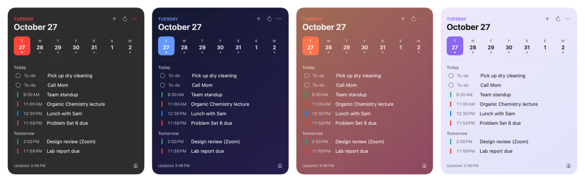
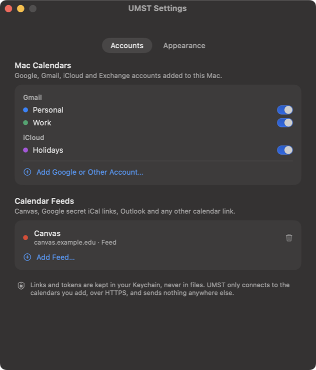
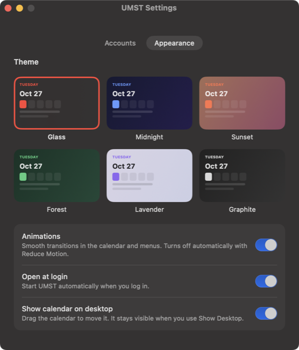

# UMST — Ultimate Mac Scheduling Tool

**A free, open-source desktop calendar and menu bar app for macOS.** See Google Calendar, iCloud, Outlook and Canvas LMS deadlines in one glass widget on your desktop, add to-dos in two keystrokes, open your most-used sites from the menu bar, and clear your screen with a one-click Show Desktop.



[](#requirements)
[](Sources/UMST)
[](LICENSE)
[](https://github.com/nicoleyangcoding/UMST-UltimateMacSchedulingTool/releases/latest)

## Install

Paste this into Terminal:

```sh
curl -fsSL https://raw.githubusercontent.com/nicoleyangcoding/UMST-UltimateMacSchedulingTool/main/install.sh | zsh
```

It downloads the latest release, checks its SHA-256 checksum, installs `UMST.app` to `~/Applications` and opens it. Run the same command again to update.

<details>
<summary>Other ways to install</summary>

**Download.** Get `UMST.zip` from the [latest release](https://github.com/nicoleyangcoding/UMST-UltimateMacSchedulingTool/releases/latest), unzip it and move `UMST.app` to Applications. UMST isn't notarized by Apple yet, so the first time you open it macOS will block it: go to **System Settings → Privacy & Security** and click **Open Anyway**.

**Build from source.** Requires the Xcode Command Line Tools (`xcode-select --install`).

```sh
git clone https://github.com/nicoleyangcoding/UMST-UltimateMacSchedulingTool.git
cd UMST-UltimateMacSchedulingTool
./scripts/install-from-source.sh
```
</details>

## Features

**Desktop calendar**
- A calendar widget that sits on your desktop, under your windows, showing the next two weeks.
- Pulls from every calendar on your Mac (Google / Gmail, iCloud, Exchange, Outlook), plus Canvas, school portals and any iCal feed.
- Stays visible when you use Show Desktop. Drag it anywhere; it remembers where you put it.
- Tap a day in the week strip to jump to it. Hover a to-do to check it off.

**Quick add**
- Click the calendar-plus icon in the menu bar, type, press Return.
- Items go on today by default and disappear at midnight. Pick Tomorrow or any date with one click.

**Quick Links**
- A compact menu of the sites and apps you use most, grouped into Personal, School and Work.
- Each link can open in a specific Chrome profile, so school links open signed in to your school account and work links to your work account.
- **Add Link…** adds a site in one step. Optional Desktop folders with one-click launchers for every link.

**Show Desktop**
- One click hides every app; a second click brings everything back exactly as it was, tabs and all.

**Themes and animations**
- Six themes: Glass, Midnight, Sunset, Forest, Lavender and Graphite.
- Smooth, subtle animations you can turn off. Reduce Motion is respected automatically.

<p align="center">
  
  
</p>

## Connecting calendars

Open **Settings → Accounts** from the widget's `•••` menu, the person icon on the widget, or the Quick Links menu.

| Calendar | How to connect |
| --- | --- |
| Google Calendar / Gmail | Add the account in **System Settings → Internet Accounts** with Calendars turned on. Meeting invites, Zoom links and events Mail finds appear automatically. |
| iCloud, Exchange, Outlook 365 | Same as above. Each calendar can be shown or hidden in Settings. |
| Canvas LMS | In Canvas open **Calendar → Calendar Feed**, copy the link and paste it into **Add Feed**. Or use a Canvas access token for the planner API. |
| Anything with an iCal / `.ics` / `webcal://` link | Paste it into **Add Feed** (Google's secret iCal address, Outlook published calendars, sports schedules, school portals). |

The calendar refreshes when you log in, at midnight, when your Mac wakes, the moment macOS Calendar changes, and whenever you click refresh.

## How it compares

| | UMST | Itsycal | macOS Calendar widget | Fantastical | CourseWatch |
| --- | :-: | :-: | :-: | :-: | :-: |
| Free and open source | ✓ | ✓ | – | – | ✓ |
| Calendar on the desktop | ✓ | – | ✓ | ✓ | – |
| Menu bar quick add | ✓ | – | – | ✓ | ✓ |
| Canvas deadlines built in | ✓ | – | – | – | ✓ |
| Any iCal feed without subscribing in Calendar | ✓ | – | – | – | – |
| Quick Links per Chrome profile | ✓ | – | – | – | – |
| One-click Show Desktop | ✓ | – | – | – | – |
| Themes | ✓ | – | – | ✓ | – |

UMST is built for students and anyone juggling school, work and personal calendars who wants everything in one glance, without a subscription.

## Privacy and security

- No accounts, no analytics, no servers. UMST only talks to the calendars and sites you add.
- Feed links and API tokens live in your macOS Keychain, never in plain files.
- HTTPS only, ephemeral network sessions (no cookies or cache on disk) and size-limited downloads.
- Data files are readable only by your user account. The app runs with the hardened runtime.

Details are in [SECURITY.md](SECURITY.md).

## Requirements

- macOS 14 Sonoma or later, Apple silicon or Intel
- Google Chrome is optional (only for opening links in specific Chrome profiles; otherwise your default browser is used)

## Uninstall

```sh
curl -fsSL https://raw.githubusercontent.com/nicoleyangcoding/UMST-UltimateMacSchedulingTool/main/scripts/uninstall.sh | zsh
```

This removes the app, its settings, its data and its Keychain items.

## Customizing Quick Links

Links live in `~/Library/Application Support/UMST/links.json` (open it from **Edit Links…** in the menu). Each item has a `name` and either a `url` (optionally with a Chrome `profile` such as `Default` or `Profile 1`) or an `app` name from `/Applications`. See [`config/links.example.json`](config/links.example.json).

To create Desktop folders with a launcher for every link:

```sh
python3 ~/Applications/UMST.app/Contents/Resources/make_folders.py
```

## Development

```sh
./scripts/test.sh                 # run the test suite
./scripts/build.sh                # build build/UMST.app (universal)
./scripts/install-from-source.sh  # build, install and launch
./scripts/release.sh              # test, build and package dist/UMST.zip
build/UMST.app/Contents/MacOS/UMST --demo   # run with sample data
```

```
Sources/UMST/   App source (AppKit + SwiftUI, no dependencies)
Tests/          Parser, network allow-list and launcher tests
Tools/          Icon and Desktop-launcher generators bundled into the app
Resources/      Info.plist and entitlements
scripts/        Build, test, install and release scripts
```

Issues and pull requests are welcome.

## License

[MIT](LICENSE)
